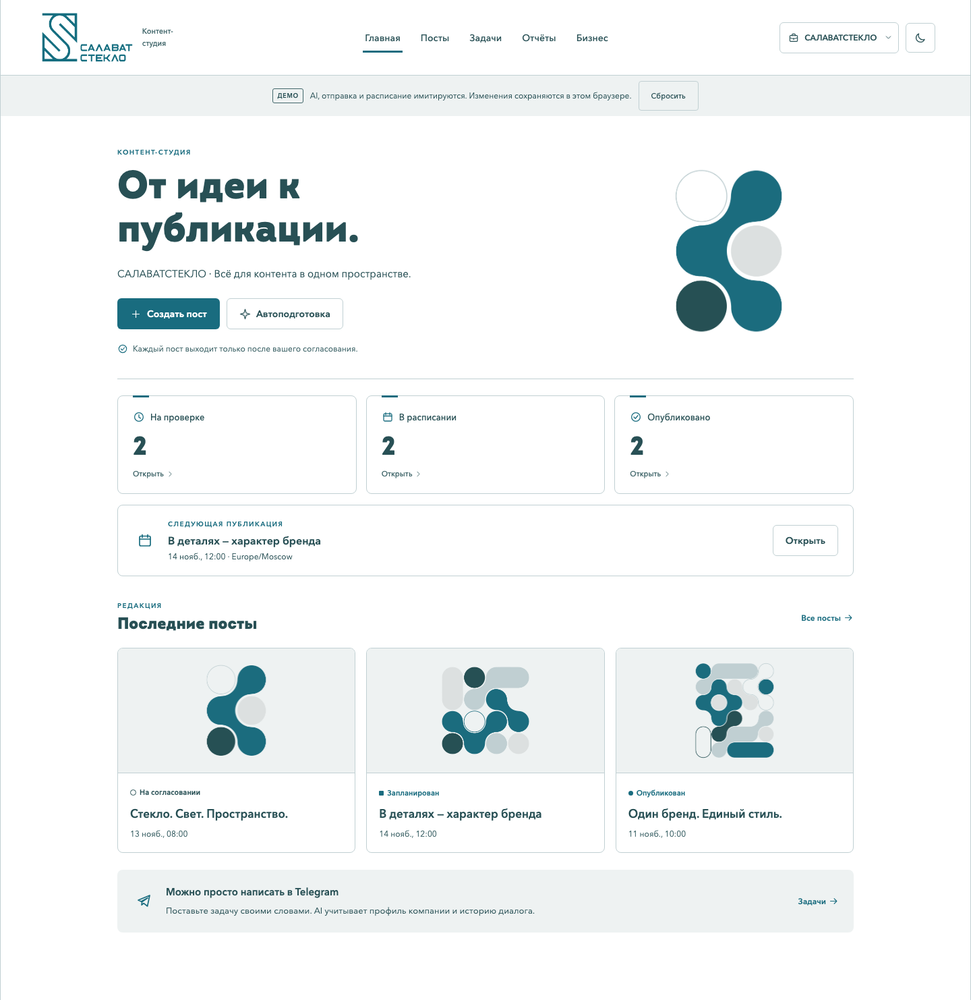

# САЛАВАТСТЕКЛО · Контент-студия

Презентация продукта: [PowerPoint с редактируемыми графиками](outputs/Salavatsteklo-product.pptx), [PDF для показа](outputs/Salavatsteklo-product.pdf). [Установленные доработки, проверки и оставшиеся задачи](docs/RELEASE_PROGRESS.md).

Последнее обновление: права и приглашения отдельно по компании, сохраняемая очередь изображений с отменой/повтором, автосохранение форм и черновики до подключения канала. Проверены настоящие AgentRouter → FLUX → черновик → согласование в изолированной базе; 1048 тестов прошли. [Как пользоваться доступом](docs/TEAM_ACCESS.md), [эксплуатация очереди](docs/OPERATIONS.md).

Передача следующему разработчику: [получение проекта и перенос рабочего окружения](docs/DEVELOPER_TRANSFER.md), [карта интерфейса, режимы, API и подключение модели](docs/FRONTEND_HANDOFF.md).

Прототип автономного AI-маркетолога для хакатона «Кибер 102»: Telegram-бот и Mini App, знания компании → диалог с памятью → текст и изображение → согласование конкретной версии → публикация по расписанию → отчёт.

Добавлен [адаптер бота сообщества ВК](docs/VK_BOT.md): вопросы и задания в личных сообщениях,
общая студия через одноразовую ссылку, привязка аккаунта и сохранение ролей.
Для реального запуска нужны `VK_GROUP_ID` и приватный `VK_GROUP_TOKEN`; без них адаптер отключён.
Это не регистрация нативного VK Mini App и не автопубликация на стену ВК: публикации пока идут в выбранный Telegram-канал.

Интерфейс оформлен по переданному брендбуку САЛАВАТСТЕКЛО: оригинальные логотипы и паттерны, петроль, Intro Black и Avenir Next Cyr. Светлая тема используется по умолчанию в preview; внутри Telegram учитывается тема клиента. [Правила оформления и происхождение файлов](docs/BRAND.md).

**Рабочий режим:** ручной профиль → текст и изображение → согласование → расписание. Компании имеют отдельные источники, историю и материалы. Текстовый провайдер переключён на [AgentRouter / gpt-6.1-sol / Responses / low](docs/AGENTROUTER.md); FLUX и модерация остаются локальными. Подключение через настоящий Codex CLI с API-ключом проверено живыми запросами. Qwen в этом режиме не используется. Тестовые компании и имитация AI доступны только в отдельном режиме разработки; рабочий Mini App не загружает их и отвергает demo-backend.

Для команды: [соответствие 12 критериям и ограничения](docs/BRIEF_COMPLIANCE.md), [сценарий защиты](docs/DEMO_SCRIPT.md), [месячные расходы](docs/COSTS.md), [Mini App и HTTPS](docs/MINI_APP.md), [локальный запуск бота и студии](docs/LOCAL_RUN.md).

Доработка для запуска на Windows: [инструкция команды и жюри](docs/WINDOWS_DEMO.md), [приглашения и отзыв доступа](docs/TEAM_ACCESS.md), [приватный FLUX API и модерация](services/flux_gateway/README.md). Локальная `qwen3:4b-instruct` прошла реальную проверку профиля, ответа, плана, текста и редакции на CPU; времена и ограничения качества указаны в [VALIDATION.md](docs/VALIDATION.md). Проверка использовала вымышленный пример, а не публикацию в Telegram; точность на материалах компании требует ручного контроля. Исторические прогоны ChatGPT/FLUX сохранены отдельно. Фирменное оформление изображения добавляется после генерации; текст и конечная картинка повторно проверяются перед отправкой. При недоступной модерации публикация блокируется.

[Результаты проверок и их границы](docs/VALIDATION.md): пользователь подтвердил вход в рабочий Mini App; с его разрешения один заранее подготовленный пост опубликован настоящим планировщиком в приватный тестовый Telegram-канал. Домашний ПК и выбранный HTTPS-прокси должны оставаться включёнными; постоянный сервер 24/7 отдельно не развёрнут. [Запуск после перезагрузки и постоянный адрес Mini App](docs/WINDOWS_STARTUP.md).

Для домашнего ПК с публичным IP настроен и проверен [прямой HTTPS без туннеля](docs/DIRECT_HTTPS.md): пользователь открыл студию и раздел «Посты» с телефона без Tailscale. Внутренние обращения к локальным FLUX и модерации идут через loopback; наружу доступен только Mini App с проверкой Telegram-подписи и прав доступа.

Добавлен [AI-контур](docs/AI_ARCHITECTURE.md): серверная инструкция, [локальный RAG по документам](docs/RAG.md), [MCP-инструменты](docs/MCP.md), роли и [проверки входа/маскировка](docs/AI_SAFETY.md), кеш точных запросов, метаданные выполнения и [воспроизводимые evals](docs/EVALS.md). В Mini App доступны «Бизнес → Источники → Поиск по документам» и «AI-диалог → Диагностика AI и базы знаний». Локальная модель ответила по выдержкам настоящего брендбука о шрифтах Intro Black и Avenir Next Cyr; проверка выполнена отдельно от рабочего пространства, без публикации. Резервная локальная модель предусмотрена, но в текущей установке не настроена.



[Мобильный предпросмотр](docs/screenshots/miniapp-mobile.png)

## Что уже работает

- SQLite/WAL: бизнес, источники, профили, планы, задания, версии постов, изображения, согласования, публикации, уведомления, метрики и аудит.
- Общие типизированные контракты для четырёх участников.
- Сохраняемая память диалога с профилем, фактами и текущими статусами; уточняющие вопросы не теряют предыдущий бриф.
- Локальный поиск по полному тексту материалов с ограниченными фрагментами и source/chunk-ссылками; отдельный индекс каждой компании, обновление и удаление устаревших источников.
- MCP stdio с явным перечнем компаний и ограниченными инструментами: поиск, статусы, диагностика и постановка черновиков в очередь. Одобрение и публикация не входят в каталог инструментов модели.
- Серверные инструкции, эвристический фильтр известных инъекций, маскировка распознаваемых данных на внешних текстовых границах и прежняя модерация. Полномочия проверяются кодом, независимо от ответа AI.
- Локальный кеш точных AI-запросов с TTL и контекстом компании; метаданные модели, длительности, ошибок и кеша без записи промптов в трейс. Синтетические evals проверяют известные сценарии, а не гарантируют качество любой модели.
- Адаптивный Mini App: компании, материалы/PDF, ручной профиль, редактор с загрузкой PNG/JPEG, календарь, поиск, согласование, AI-правки, задания, автоподготовка, пауза и отчёты.
- Фирменные логотипы, шрифты и паттерны; светлая и тёмная темы с проверкой контраста, охранного поля логотипа и адаптивности.
- Ручной сценарий с ненастроенными AI-провайдерами, сохранение демо в браузере и постоянные рабочие данные на сервере.
- Проверка владельца, принадлежности файлов и прав публикации в канале.
- Неизменяемые версии; перед долгой AI-правкой пост резервируется в `editing`, а прежнее согласование сразу снимается.
- Постоянная очередь подготовки, дедупликация запросов и лимиты генерации.
- Источники, предупреждения AI и версия профиля каждого поста; прогресс и отмена ожидающего задания.
- Общий журнал AI-операций с лимитами, пауза публикаций и ручной повтор выбранного неудачного уведомления.
- Проверяемая резервная копия базы с файлами, восстановление в новый каталог и запуск через Docker Compose.
- Пять независимых циклов: публикации, генерация, планирование автоматизаций, уведомления и метрики. Медленный внешний сервис не задерживает остальные циклы.
- Настоящий адаптер Telegram `sendPhoto`, проверка канала и сбор числа подписчиков.
- Приём снимков реакций, данные за период и интерфейс отчётов.
- Восстановление после перезапуска, привязка `DATA_DIR` к режиму и владельцу, защита от двух экземпляров и атомарная запись уведомлений вместе с результатами операций.
- Тесты без внешних запросов и CI для Windows/Linux, Python 3.11/3.12.

## Быстрый запуск без ключей

Нужны Git и Python 3.11+.

### Windows / PowerShell

```powershell
git clone https://github.com/TheMagomedov/Hackatons.git
cd Hackatons
python -m venv .venv
.\.venv\Scripts\python.exe -m pip install -r requirements-dev.txt
.\.venv\Scripts\python.exe -m app demo
```

### Linux / macOS

```bash
git clone https://github.com/TheMagomedov/Hackatons.git
cd Hackatons
python3 -m venv .venv
.venv/bin/python -m pip install -r requirements-dev.txt
.venv/bin/python -m app demo
```

Демо создаёт отдельный каталог `var/demo-…/`, проходит подготовку, правку, согласование, восстановление из базы и **имитацию** отправки. Затем автоматическое задание создаёт новый черновик, который остаётся неодобренным. В JSON-результате должны быть:

```json
{
  "mode": "offline-demo",
  "external_requests": 0,
  "request_deduplicated": true,
  "stale_approval_blocked": true,
  "unauthorized_approval_blocked": true,
  "persisted_publication_completed": true,
  "simulated_publications": 1,
  "automation_jobs_created": 1,
  "duplicate_automation_jobs": 0,
  "unapproved_drafts": 1
}
```

Без аргументов `python -m app` также запускает офлайн-демо. Оно не загружает `.env` и не включает боевые провайдеры даже при наличии токена.

Для интерфейса выполните `python -m app miniapp-preview` и откройте [локальный Mini App](http://127.0.0.1:8765/mini/). Это отдельный интерактивный предпросмотр без ключей; демо сохраняется в этом браузере до сброса, публикации и AI имитируются. [Ручной сценарий и подключение модели позже](docs/MINI_APP.md#работа-до-подключения-нейросети).

## Команды приложения

| Команда | Действие |
| --- | --- |
| `python -m app demo` | Изолированная проверка без сети и ключей |
| `python -m app miniapp-preview` | Интерактивный предпросмотр Mini App без ключей на порту 8765 |
| `python -m app init` | Инициализация/миграция базы и привязка режима/владельца, без внешних запросов |
| `python -m app check` | Проверка конфигурации и загрузки адаптеров; доступ к провайдерам не проверяется реальным запросом |
| `python -m app run` | Работа планировщика и подключённого интерфейса до остановки |
| `python -m app run --once` | Один цикл backend: подготовка, отправка одобренного поста, метрики, уведомления |
| `python -m app status --data-dir var/live` | Только чтение версии схемы, привязки и счётчиков; без `.env`, ключей, провайдеров и миграции |
| `python -m app adopt-data --data-dir var/live --mode live --owner-id 123` | Явное принятие существующих непривязанных данных с миграцией схемы, без провайдеров |
| `python -m app backup --data-dir var/live --output backups/pre-demo` | Копия базы и зарегистрированных файлов; приложение должно быть остановлено |
| `python -m app verify-backup --backup-dir backups/pre-demo` | Проверка целостности и контрольных сумм копии |
| `python -m app restore --backup-dir backups/pre-demo --data-dir var/restored` | Восстановление только в новый каталог с паузой публикаций и отключением автоматизаций |

Для обычных команд доступны `--env-file .env` и `--data-dir`. Для `status` и `adopt-data` путь обязателен; `.env` ими не читается. `--mode`/`--owner-id` относятся только к `adopt-data`, где `123` нужно заменить реальным ID владельца. В `live` команда `run --once` **может отправить уже согласованный пост**, срок которого наступил. Это инструмент интеграции, а не сухая проверка.

## Подключение реальных модулей

Мини-приложение «САЛАВАТСТЕКЛО · Контент-студия» можно посмотреть локально через `python -m app miniapp-preview`.
Подключение кнопки и HTTPS описано в [инструкции Mini App](docs/MINI_APP.md).

Сначала каждый участник читает [передачу модулей по ролям](docs/ROLE_HANDOFF.md). Для роли 3 есть отдельное [руководство Telegram-интеграции](docs/TELEGRAM_INTEGRATION.md).

1. Скопируйте `.env.live.example` в `.env` один раз. `.env.example` предназначен для demo и оставляет `BOT_FACTORY` пустым.
2. Укажите `APP_MODE=live`, отдельный `DATA_DIR=var/live`, настоящий `OWNER_TELEGRAM_ID` и токен вашего бота. Для постоянной demo-базы используйте `var/demo`.
3. Настройте [AgentRouter](docs/AGENTROUTER.md) и проверьте доступ ключа к модели. Изображения и обязательная модерация настраиваются отдельно. Альтернативный локальный режим описан в [LOCAL_TEXT.md](docs/LOCAL_TEXT.md).
4. Выполните `python -m app check`, затем `python -m app run`. В личном чате с ботом отправьте `/start`. Проверка конфигурации не подтверждает доступность модели; Windows bootstrap отдельно проверяет готовность зависимостей.
5. Для проверки публикации добавьте бота в тестовый канал с правом публикации. Владелец должен быть администратором канала. Через бота подтвердите профиль, подключите канал и согласуйте конкретную версию подготовленного поста с будущим временем.

Пример конфигурации для Telegram:

```dotenv
APP_MODE=live
DATA_DIR=var/live
OWNER_TELEGRAM_ID=ваш_числовой_Telegram_ID
TELEGRAM_BOT_TOKEN=ваш_секретный_токен
AI_PROVIDER_FACTORY=app.ai.agentrouter:build_provider
CODEX_CLI_PATH=C:/path/to/native/codex.exe
IMAGE_PROVIDER_FACTORY=app.media.runtime:build_provider
REPORT_PROVIDER_FACTORY=app.reports.provider:build_provider
BOT_FACTORY=app.bot.adapter:build_bot
TEXT_API_KEY=
TEXT_API_BASE=https://agentrouter.org/v1
TEXT_MODEL=gpt-6.1-sol
TEXT_WIRE_API=responses
TEXT_REASONING_EFFORT=low
TEXT_TIMEOUT_SECONDS=120
PROVIDER_TIMEOUT_SECONDS=300
IMAGE_API_KEY=
IMAGE_MODEL=your_image_model
```

Текстовый адаптер использует настоящий Codex CLI и Responses API с JSON-ответом и проверками Pydantic/ModelAI; доступ к модели нужно подтвердить отдельным запросом. Изображения используют `IMAGE_API_KEY`, `IMAGE_MODEL`, `IMAGE_API_BASE`; обязательная модерация — `MODERATION_API_KEY` и `MODERATION_API_BASE`. Дополните пример приватными настройками по `.env.live.example`. Telegram и загрузка URL-источников используют сеть. Запускайте один polling-процесс на токен.

В меню постов сначала показываются новые записи. В предпросмотре можно выбрать «Через 15 мин», «Через час» или указать дату со смещением. Бот покажет новую версию и отдельную кнопку согласования. Команда `/help` показывает порядок действий.

`build_provider(settings)` — синхронная фабрика, которая возвращает объект протокола из `app/shared/ports.py`. Его внешние операции асинхронные. `build_bot(service, settings)` возвращает объект с `async run(stop_event)` и `async send(notification)`; при наличии `close()` runtime вызовет его при остановке.

Фабрики создают клиенты, но не запускают фоновые задачи и не делают запросы при импорте. Одним жизненным циклом управляет `app/core/runtime.py`. Встроенные demo-провайдеры запрещены в `live`.

## Распределение файлов

| Роль | Каталоги | Граница ответственности |
| --- | --- | --- |
| 1: ML/AI | `app/ai`, `tests/ai` | Источники, профиль, намерения, планы, тексты |
| 2: Backend | `app/core`, `app/shared`, `app/storage`, `app/publishing`, `app/scheduler`, конфигурация, запуск | Хранение, согласование, задания, реальные публикации, интеграция |
| 3: Telegram | `app/bot`, `tests/bot` | Диалог с владельцем; события и кнопки передаются в backend |
| 4: Media/Analytics | `app/media`, `app/reports`, соответствующие тесты | Изображения и расчёт отчётов из `ReportInput` |

Зависимости, `.env.example`, общие типы и точку запуска меняем согласованно через роль 2. Генерируемые файлы сохраняются в `var`, который исключён из Git.

## Правила публикации

1. Подтверждение профиля или контент-плана не одобряет пост.
2. Согласование относится к `post_id + revision`: текст, изображение, проверенный канал и время.
3. Ручная правка возвращает новую версию в `review`. AI-правка сначала переводит пост в `editing` и снимает согласование **до сетевого запроса**; успех возвращает новый `PostView` в `review`, ошибка оставляет `failed`. Берите revision из результата, не вычисляйте `старый + 1`.
4. Только `approved` с совпадающей версией может атомарно перейти в `publishing`.
5. При успехе сохраняются ID сообщения, ссылка и фактическое время.
6. Явный отказ Telegram переводит пост в `failed`. Для повтора требуется исправление/новое время и согласование.
7. При неизвестном результате отправки используется `delivery_unknown`. Автоматического повтора нет: владелец проверяет канал и вызывает `resolve_unknown_delivery` через интерфейс.

Пост хранит `profile_version`, `used_source_ids` и `warnings`; бот показывает источники и предупреждения при предпросмотре. После изменения профиля или для старого поста с неизвестным контекстом согласование блокируется. Проверьте текст и нажмите «Проверил текст по новому профилю» либо исправьте текст, затем отдельно согласуйте новую версию. Изменение только времени или картинки не подтверждает актуальность текста.

«Приостановить публикации» блокирует новые отправки одобренных постов. Автоподготовка управляется отдельно и создаёт только черновики. Уже начавшаяся сетевая отправка не отменяется обещанием паузы. После возобновления сохраняется проверка допустимого опоздания.

После короткого простоя одобренные посты могут выйти с опозданием до `MAX_PUBLISH_LATENESS_SECONDS` (по умолчанию 900 секунд). При большем опоздании пост переводится в `failed`, владелец получает уведомление и выбирает новое время. Неодобренный пост нельзя согласовать на уже прошедшее время.

Если приложение прервано во время отправки, после запуска `publishing` становится `delivery_unknown`. Прерванные задания генерации и посты в `editing` становятся `failed`; старое согласование не восстанавливается, платный вызов автоматически не повторяется.

Состояния: `review`, `editing`, `approved`, `publishing`, `published`, `rejected`, `failed`, `delivery_unknown`. Все значимые переходы записываются в аудит.

## Автоматическая работа и лимиты

- `configure_automation` включает или выключает подготовку для бизнеса.
- Период — от 1 до 720 часов; время хранится в UTC, пользователь видит свой IANA timezone.
- На пропущенные периоды не создаётся лавина заданий: один актуальный запуск, затем следующее время.
- Дедупликация работает по идентификатору пользовательского запроса и по периоду автоматического запуска.
- По умолчанию: до 3 постов на задание, до 5 ожидающих/выполняемых заданий, до 10 заданий в сутки бизнеса. Параметры в `.env.example`.
- Вызовы провайдеров ограничены таймаутом. Повторной платной генерации после ошибки без нового задания нет.
- Общий журнал допускает по умолчанию **100 логических AI-операций на владельца за сутки UTC** и **2 одновременно**: анализ, распознавание запросов, план, тексты, изображения и правки. Это счётчик вызовов, не денежный бюджет и не количество HTTP-запросов. Внутренние повторы ограничены отдельно: `AI_MAX_RETRIES=1` допускает один повтор или исправление ответа текстового провайдера.
- Неудачные и прерванные операции учитываются в лимите и не повторяются автоматически. Стабильные ID входящих Telegram-событий сохраняются до обработки; повтор после перезапуска не превращается в новое платное действие. Прерванное пользовательское действие повторяется новым сообщением/нажатием.
- Очередь показывает этап, прогресс и время изменения. Отменить можно только ещё не начатое задание; отмена освобождает место в ожидающей очереди, но не стирает дневную историю заданий.

## Метрики и уведомления

Backend хранит снимки реакций и подписчиков. Реакции — текущее количество, а не сумма всех пришедших снимков. Источник снимков подписчиков включает канал, чтобы не сравнивать разные каналы как одну аудиторию. События дедуплицируются. Отсутствующие метрики не заменяются нулём.

`report_data` возвращает посты бизнеса и метрики выбранного периода плюс последний снимок до начала периода для каждой серии. Форматирование и интерпретация принадлежат роли 4. Текущий статус поста не является историческим статусом на конец прошлого периода; не называйте такой срез историческим отчётом о согласованиях.

Нужное уведомление и результат операции сохраняются в outbox одной транзакцией: сбой не оставляет завершённую операцию без записи уведомления. Доставка повторяется ограниченно с задержкой. Если Telegram принял уведомление, а процесс упал до сохранения подтверждения, владелец может увидеть его повторно. Это не разрешает повторную публикацию поста. После 5 неудачных попыток доставка уведомления останавливается; состояние остаётся доступно через API и `status`.

Меню «Неудачные уведомления» позволяет вернуть конкретное уведомление в очередь с аудитом. Генерация и публикация при этом не запускаются заново. `status` и история AI показывают ID операций, этапы, времена и безопасные коды причин без содержимого запросов/ответов.

## Данные при обновлении проекта

Текущая схема — **v4**: v1/v2/v3 автоматически мигрируют при инициализации без перезаписи прежних ревизий. В v2 добавлена привязка `mode + owner_id`; в v3 — журнал AI-операций и входящих событий; в v4 — история диалога каждой компании. Новая пустая база привязывается автоматически; существующая непустая база без привязки требует отдельного принятия. Уже записанную привязку нельзя сменить через настройки или `adopt-data`. У старых постов `profile_version=None`: перед согласованием нужен явный просмотр по актуальному профилю.

Для старой базы:

1. Остановите приложение и выполните `python -m app backup --data-dir var/live --output backups/before-upgrade`, затем `python -m app verify-backup --backup-dir backups/before-upgrade`.
2. Выполните `python -m app status --data-dir var/live`. Команда ничего не мигрирует. Сверьте назначение каталога и владельца по своим данным; `binding: null` означает отсутствие привязки, а не разрешение угадать режим.
3. Только для подтверждённой старой live-базы выполните `python -m app adopt-data --data-dir var/live --mode live --owner-id 123`, заменив ID на реальный. Команда требует остановленного приложения и не вызывает провайдеров.
4. Повторите `status`, настройте тот же путь, режим и владельца в `.env`, затем выполните `check` и `run`.

Если каталог уже привязан иначе, используйте соответствующий ему режим/владельца либо отдельный каталог для нового окружения. Не удаляйте привязку и не меняйте флаги demo у постов ради обхода проверки. Изолированная команда `demo` по-прежнему создаёт собственный новый подкаталог и не использует живую базу.

## Эксплуатация

Приложение рассчитано на один процесс и одного владельца в MVP. Держите один `run` для одного `DATA_DIR`; блокировка ОС предотвращает повторный запуск CLI. Не запускайте несколько polling-процессов с одним токеном Telegram.

Для размещения: постоянный Python-процесс, доступ к интернету, постоянный диск для `var`, секреты в окружении. Контейнеризация не обязательна. Не храните `var` на временном диске. Для переноса/резервной копии остановите приложение штатно и сохраните весь каталог данных, включая базу и изображения; не копируйте только открытый SQLite-файл, игнорируя WAL.

Готовые команды Docker Compose, backup/restore и диагностики приведены в [OPERATIONS.md](docs/OPERATIONS.md). Restore пишет только в новый каталог, сохраняет владельца/режим, приостанавливает публикации, выключает автоматизации и отменяет ожидающие задания. Сохранённые pending-уведомления после запуска восстановленного приложения могут прийти повторно.

Токены не записываются в исходники, логи или ответы об ошибке. HTTP-логи адаптера Telegram скрывают токен в URL. Не включайте сторонний HTTP wire logging с телами запросов в боевом окружении.

Сайт загружает модуль роли 1: он обязан проверять разрешённые публичные адреса, DNS и каждый redirect, а также ограничивать объём и время загрузки. Backend регистрирует источник и отклоняет очевидные локальные URL, но не является сетевым загрузчиком страниц.

## Проверки

```powershell
.\.venv\Scripts\python.exe -m ruff check .
.\.venv\Scripts\python.exe -m pytest -q
.\.venv\Scripts\python.exe -m app demo
```

Проверяются права, чужие файлы, гонки версий и профилей, неизменяемость ревизий, параллельный захват очереди, таймауты/отмены, восстановление, дневные лимиты, повторные события, безопасные ошибки Telegram, сохранение неизвестного результата отправки, пути файлов и SHA-256. Транспорт Telegram проверяется через HTTP-моки; настоящий токен для тестов не требуется.

Интеграционные тесты используют реальные классы адаптеров с подставным транспортом. Они не подтверждают доступность модели, права настоящего бота или качество реальной генерации. Ручной сквозной прогон перед защитой описан в [ACCEPTANCE.md](docs/ACCEPTANCE.md).

## Работа команды через Git

Владелец приглашает участников в GitHub → Settings → Collaborators; приглашения нужно принять. Каждый начинает свою ветку от принятого каркаса:

```bash
git switch main
git pull --ff-only origin main
git switch -c codex/ai-content
```

Для остальных ролей: `codex/backend`, `codex/telegram-bot`, `codex/media-analytics`. Ветки интеграции создавайте от принятого состояния `main`; изменения из открытого PR подключайте только после согласования общего базового commit.

Пишите небольшой законченный блок, проверяйте его, делайте commit и push в свою ветку, затем PR в `main`. В PR укажите изменения, интерфейсы, новые зависимости/настройки и способ проверки. Общие файлы изменяем согласованно. Не добавляйте в Git ключи, `.env`, виртуальное окружение, локальную базу и пользовательские документы.

## Документация и границы MVP

- [Контракты и передача работы ролям 1/3/4](docs/ROLE_HANDOFF.md)
- [Подключение Telegram-интерфейса](docs/TELEGRAM_INTEGRATION.md)
- [Решения архитектуры и проверка перед демонстрацией](docs/ARCHITECTURE.md)
- [Запуск, миграции и восстановление](docs/OPERATIONS.md)
- [Сквозная проверка перед защитой](docs/ACCEPTANCE.md)
- [Полное ТЗ: реализованное, проверки и границы](docs/BRIEF_COMPLIANCE.md)
- [Защита за 5–7 минут](docs/DEMO_SCRIPT.md)
- [Локальный текст через Ollama](docs/LOCAL_TEXT.md)
- [System prompt, RAG, инструменты, кеш и наблюдаемость](docs/AI_ARCHITECTURE.md)
- [Договоры, регламенты и локальная база знаний](docs/RAG.md)
- [MCP-сервер и разрешённые действия](docs/MCP.md)
- [Защита от инъекций и маскировка данных](docs/AI_SAFETY.md)
- [Синтетические evals и границы измерений](docs/EVALS.md)
- [Необязательный облачный режим ChatGPT](docs/CHATGPT_CONNECTION.md)
- [Оценка месячных расходов](docs/COSTS.md)

В MVP входят Telegram, несколько компаний одного оператора, текст, публичная страница сайта и PDF с текстовым слоем. Роли действуют в общем командном пространстве; независимые клиентские кабинеты с разрешениями по компаниям и отдельный OAuth-провайдер не реализованы. VK/MAX, мониторинг комментариев, исследование конкурентов и генерация видео остаются доработками. Подготовка выполняется автономно; публикация требует согласования версии. Один согласованный реальный пост подтверждён прежним прогоном. Текущий домашний ПК должен оставаться включённым: требование 24/7 независимо от ПК администратора требует отдельного размещения.

## Обновление студии 14.11

Добавлены текстовые посты, история версий, архив галереи, расширенное автосохранение, ключи интеграций и квоты компаний. [API для своего бота](docs/INTEGRATION_API.md). [DOCX, OCR и семантический RAG](docs/RAG.md). [Проверки и точные ограничения](docs/RELEASE_PROGRESS.md).

Актуальная презентация: [PowerPoint](outputs/Salavatsteklo-product-release.pptx), [PDF](outputs/Salavatsteklo-product-release.pdf).
